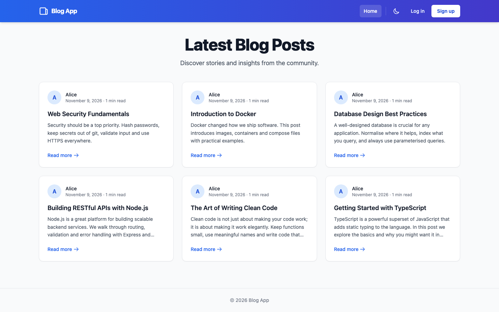
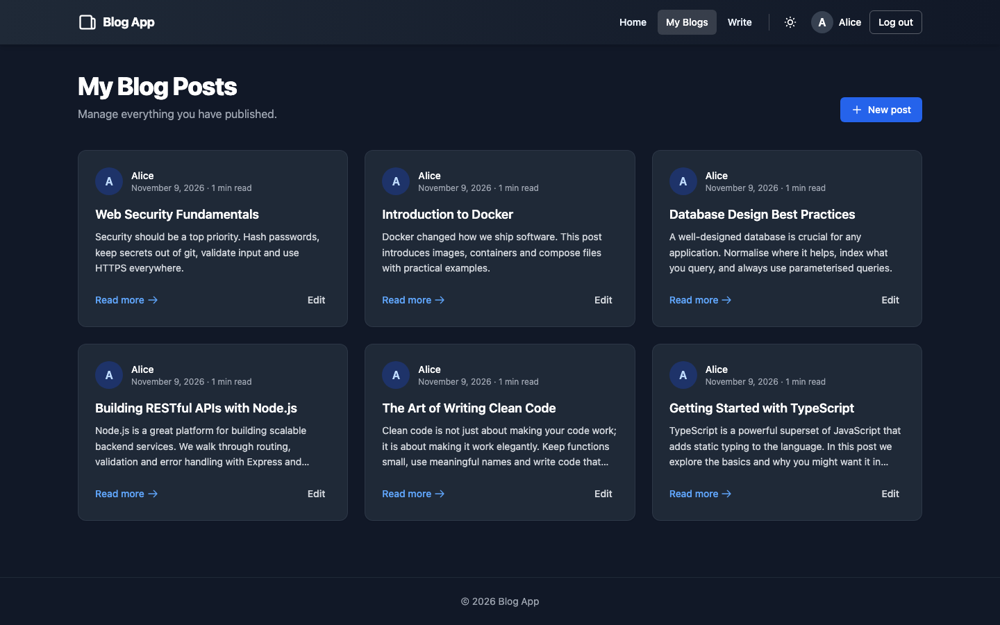
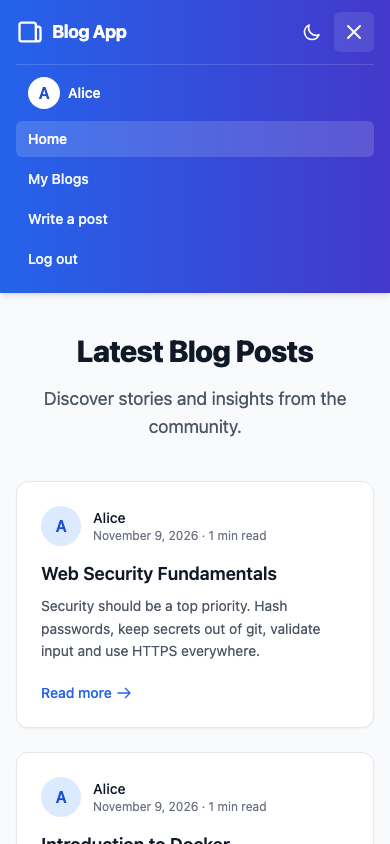

# Blog App

A full-stack blogging platform with JWT authentication, post CRUD, pagination and dark mode. It uses React + TypeScript + Tailwind on the frontend and Express + TypeScript + PostgreSQL on the backend.


[](https://github.com/VamsiKrishnaThota03/blog-app/actions/workflows/ci.yml)
[](https://github.com/VamsiKrishnaThota03/blog-app/actions/workflows/codeql.yml)
[](LICENSE)

## Live demo

**https://blog-app-seven-ruddy.vercel.app**

The frontend runs on Vercel, the API on Render (`https://blog-api-rer9.onrender.com/api`) and the database on Neon PostgreSQL.

| Home feed | My Blogs (dark mode) | Mobile menu |
| --- | --- | --- |
|  |  |  |

## Overview

The repository is a two-package monorepo:

- **`client/`** is a Vite + React 19 + TypeScript single-page app styled with Tailwind CSS. Auth state lives in a React context, and the JWT is stored in the browser and sent as a `Bearer` token on API calls (`axios`).
- **`server/`** is an Express + TypeScript REST API. It uses raw SQL through `pg` (node-postgres) against PostgreSQL. Passwords are hashed with `bcryptjs` and requests are authenticated with JWTs.

## Features

- **Authentication:** register with name, email and password, then log in to get a JWT. The `/api/auth/me` endpoint restores the session.
- **Protected routes:** create, edit and "My Blogs" pages require login (`ProtectedRoute`)
- **Posts CRUD:** create, read, update and delete posts. The server only lets the post's author update or delete it.
- **Public feed with pagination:** `GET /api/posts?page=&limit=` returns posts with author name and the page count. The home page renders page buttons.
- **Post detail page** with author, date and reading time; Edit/Delete only shown to the author
- **My Blogs dashboard:** list and edit your own posts
- **Dark mode:** follows the system preference until you toggle it; the choice is saved to `localStorage`
- **Responsive UI** built with Tailwind CSS: collapsible mobile menu, loading, empty and error states, 404 page
- **Server-side validation:** required fields, length limits, email format, numeric IDs and a capped page size
- **Database scripts:** `init-db` applies `schema.sql`, and `seed` inserts sample posts
- **Health check:** `GET /health`

## Tech stack

| Layer | Tools |
| --- | --- |
| Frontend | React 19, TypeScript, Vite 6, React Router 6, Tailwind CSS 3, axios |
| Backend | Node.js, Express 4, TypeScript, `pg`, `jsonwebtoken`, `bcryptjs`, `cors`, `dotenv` |
| Database | PostgreSQL (Neon in production) |
| Hosting | Vercel (client), Render (server, `Procfile`) |
| Hardening | `helmet` (CSP, HSTS, nosniff), `express-rate-limit` (per IP+email on auth, per user on writes) |
| Observability | `pino` / `pino-http` structured JSON logs, `x-request-id` correlation, liveness + readiness probes |
| API contract | OpenAPI 3.0 served at `/openapi.json`, Swagger UI at `/api-docs` |
| Quality gates | GitHub Actions: typecheck, ESLint, Prettier, 25 tests against a real Postgres, Docker image build, CodeQL |
| Local stack | `docker compose up` — Postgres + API, every port bound to `127.0.0.1` |

## Architecture

```
                     ┌──────────────────────────────┐
   browser  ───────► │  Vercel — React 19 SPA       │
                     │  AuthContext + ThemeContext  │
                     └──────────────┬───────────────┘
                                    │  HTTPS, Bearer JWT
                                    ▼
        ┌────────────────────────────────────────────────────┐
        │  Render — Express API                              │
        │                                                    │
        │  helmet ─► pino-http (x-request-id) ─► CORS        │
        │     ─► json(1mb) ─► globalLimiter                  │
        │                                                    │
        │  /health          liveness, no DB touch            │
        │  /health/ready    SELECT 1, 503 when DB is down    │
        │  /api-docs        Swagger UI                       │
        │                                                    │
        │  /api/auth/*   authLimiter ─► bcrypt ─► HS256 JWT  │
        │  /api/posts    public reads  │  gated writes       │
        │                              └─ authenticateToken  │
        │                                 + writeLimiter     │
        └───────────────────────┬────────────────────────────┘
                                │  pg Pool, verified TLS
                                ▼
                     ┌──────────────────────────────┐
                     │  Neon PostgreSQL             │
                     │  users ──1:N──► posts        │
                     └──────────────────────────────┘
```

**Authorization model.** The post feed is deliberately anonymous — it is a public
blog. Everything that writes, or that reads one user's data, requires a bearer
token. Ownership is not a separate lookup: every `UPDATE` and `DELETE` carries
`AND user_id = $caller` in the statement itself, so a forged id cannot touch
another author's row and the "not found" and "not yours" cases are
indistinguishable to the caller.

## Project structure

```
blog-app/
├── client/
│   ├── src/
│   │   ├── pages/          # Home, Login, Register, PostDetail, CreatePost, EditPost, MyBlogs
│   │   ├── components/     # Navbar, PostCard, PostForm, AuthCard, Alert, Spinner, ProtectedRoute
│   │   ├── context/        # AuthContext, ThemeContext (dark mode)
│   │   ├── services/       # axios API client
│   │   ├── utils/          # date formatting, API error messages
│   │   └── config.ts       # API base URL (VITE_API_URL, /api proxy in dev, Render in prod)
│   ├── vercel.json         # SPA rewrites so deep links work
│   └── vite.config.ts      # dev server on :3000, proxies /api to :4000
├── server/
│   ├── schema.sql          # users + posts tables
│   ├── Dockerfile          # multi-stage, non-root, HEALTHCHECK
│   ├── Procfile
│   ├── src/
│   │   ├── index.ts            # bootstrap: validate config, bind, graceful shutdown
│   │   ├── app.ts              # Express app factory (no listen — testable)
│   │   ├── openapi.ts          # OpenAPI 3.0 document
│   │   ├── config/env.ts       # required env vars (fails fast), bind host, CORS origins
│   │   ├── config/database.ts  # pg Pool from DATABASE_URL, TLS settings
│   │   ├── controllers/        # authController, postController
│   │   ├── middleware/auth.ts      # JWT verification (HS256 pinned)
│   │   ├── middleware/security.ts  # helmet + the three rate limiters
│   │   ├── middleware/logging.ts   # pino-http, request ids, redaction
│   │   ├── routes/             # auth.ts, posts.ts
│   │   ├── utils/              # db pool accessor, input validation
│   │   └── scripts/            # initDb.ts, seed.ts
│   └── test/
│       ├── validation.test.js  # unit tests
│       └── api.test.js         # supertest end-to-end against real Postgres
├── docker-compose.yml      # Postgres + API, published only on 127.0.0.1
└── .github/workflows/      # ci.yml, codeql.yml
```

## Getting started

### Prerequisites

- Node.js 20+ and npm
- A PostgreSQL database (local, Docker, or a hosted provider such as Neon)

### Option A: Docker (one command)

Brings up Postgres with the schema applied and the API wired to it. Both ports
are published on `127.0.0.1` only, so nothing is reachable from your network.

```bash
cat > .env <<'EOF'
POSTGRES_PASSWORD=<choose-one>
JWT_SECRET=<openssl rand -hex 32>
EOF

docker compose up --build
open http://localhost:4000/api-docs
```

Compose fails fast with a named error if either variable is missing, rather than
starting with a default password.

### Option B: run the pieces directly

#### 1. Backend

```bash
cd server
npm install
```

Copy `server/.env.example` to `server/.env` and fill it in. The server refuses to start if `DATABASE_URL` or `JWT_SECRET` is missing; there are no built-in fallback secrets.

| Variable | Required | Description |
| --- | --- | --- |
| `DATABASE_URL` | Yes | PostgreSQL connection string |
| `JWT_SECRET` | Yes | Long random string used to sign JWTs (`openssl rand -hex 32`) |
| `PORT` | No | API port (default `4000`) |
| `HOST` | No | Bind address. Defaults to `127.0.0.1`, or `0.0.0.0` when a managed platform marker (`RENDER`, `FLY_APP_NAME`, `RAILWAY_ENVIRONMENT`, `DYNO`) is present. Set explicitly to override. |
| `LOG_LEVEL` | No | `pino` level (`silent`…`trace`). Default `info` in production, `debug` otherwise. |
| `CORS_ORIGINS` | No | Comma-separated allowed origins (default: the Vercel domain, `http://localhost:3000`, `http://localhost:5173`) |
| `DB_SSL` | No | Unset: TLS with certificate verification (no TLS for `localhost`). `no-verify`: TLS without verification. `disable`: no TLS. |
| `SEED_USER_EMAIL` | No | Demo account email for `npm run seed` (default `demo@example.com`) |
| `SEED_USER_PASSWORD` | For `seed` | Demo account password; the seed script will not run without it |

Create the tables, optionally seed sample data, and start the API:

```bash
npm run init-db     # applies schema.sql (idempotent)
SEED_USER_PASSWORD=<choose-one> npm run seed   # optional: demo user + sample posts
npm run dev         # nodemon + ts-node on http://localhost:4000
npm test            # compiles, then runs unit + API tests
```

| Command (server) | Description |
| --- | --- |
| `npm run dev` | Watch mode on `http://localhost:4000` |
| `npm run typecheck` | `tsc --noEmit` |
| `npm run lint` | ESLint (flat config, `typescript-eslint`) |
| `npm run format:check` | Prettier, as CI runs it |
| `npm test` | Unit tests, plus the full API suite when `DATABASE_URL` is set |
| `npm run test:coverage` | Same, with `node:test` coverage output |

The API suite in `server/test/api.test.js` drives the real Express app with
supertest and asserts on behaviour that unit tests cannot reach: token forgery
and `alg=none` rejection, cross-author edit and delete attempts, page-size
clamping, login not revealing whether an account exists, and malformed JSON
producing a 400 rather than a 500. It **skips itself** when `DATABASE_URL` is
absent, so `npm test` still passes on a machine with no database; CI always
runs it against a Postgres service container.

Production build:

```bash
npm run build       # npm install && tsc -> dist/
npm start           # node dist/index.js
```

### 2. Frontend

```bash
cd client
npm install
npm run dev         # Vite dev server
```

The dev server runs on `http://localhost:3000` and proxies `/api` to `http://localhost:4000` (override with `API_PROXY_TARGET`). Production builds call the Render URL unless `VITE_API_URL` is set at build time (see `client/.env.example`).

| Command (client) | Description |
| --- | --- |
| `npm run dev` | Start the dev server |
| `npm run build` | Type-check and build into `dist/` |
| `npm run preview` | Preview the production build |
| `npm run lint` | Run ESLint |
| `npm test` | Vitest in watch mode |
| `npm run test:run` | Vitest once, as CI runs it |
| `npm run test:coverage` | Vitest with v8 coverage |

24 frontend tests run under Vitest + Testing Library in jsdom. They cover the
date/excerpt/reading-time helpers (including the `Invalid Date` path), API error
mapping (network failure vs. a server message vs. the fallback), `PostCard`
rendering and escaping, and all four `ProtectedRoute` outcomes — no token,
valid token, a session check still in flight, and a rejected token. The API
module is mocked, so the suite never touches the network.

The production build splits React/router and axios into their own chunks, so
shipping an app-code change does not invalidate the cached vendor bundle.

## API

Base path: `/api`. Protected routes need `Authorization: Bearer <token>`.

| Method | Path | Auth | Purpose |
| --- | --- | --- | --- |
| POST | `/api/auth/register` | - | Register (`name`, `email`, `password`) and return a token and user |
| POST | `/api/auth/login` | - | Log in and return a token and user |
| GET | `/api/auth/me` | Yes | Current user |
| GET | `/api/posts?page=&limit=` | - | Paginated list of posts with author names |
| GET | `/api/posts/:id` | - | Single post |
| POST | `/api/posts` | Yes | Create a post (`title`, `content`) |
| PUT | `/api/posts/:id` | Yes (author) | Update your own post |
| DELETE | `/api/posts/:id` | Yes (author) | Delete your own post |
| GET | `/api/posts/user/me` | Yes | Posts by the current user |
| GET | `/health` | - | Liveness — 200 whenever the process is accepting connections |
| GET | `/health/ready` | - | Readiness — `SELECT 1`; 503 when the database is unreachable |
| GET | `/openapi.json` | - | Machine-readable OpenAPI 3.0 document |
| GET | `/api-docs` | - | Swagger UI, with "Authorize" wired to the bearer scheme |

Interactive docs: **https://blog-api-rer9.onrender.com/api-docs**

### Rate limits

| Scope | Window | Limit | Key |
| --- | --- | --- | --- |
| All routes | 15 min | 600 | client IP |
| `register`, `login` | 15 min | 10 | IP + submitted email |
| Post create/update/delete | 1 min | 30 | user id |

Successes count against the auth limit as well as failures, so a valid login
cannot be used to refill an attacker's budget. The limiters read `req.ip`, which
is resolved through exactly one proxy hop (`trust proxy = 1`) — trusting every
hop would let a client spoof `X-Forwarded-For` and bypass them entirely.

### Observability

Every request emits one structured JSON line and carries an `x-request-id`
(echoed from the caller when supplied, otherwise generated), so a user-reported
error maps to a single log line. `authorization`, `cookie`, `set-cookie` and
`password` are redacted before serialisation. Health checks are excluded from
the access log. 5xx responses never include an internal message or stack — the
request id is the handle for correlating with the log.

## Deployment notes

- **Client (Vercel):** framework preset Vite, root `client`, build `npm run build`, output `dist`. `client/vercel.json` rewrites all paths to `index.html` so refreshing `/post/:id` works. Optionally set `VITE_API_URL`.
- **Server (Render):** root `server`, build `npm run build`, start `npm start`. Set `DATABASE_URL` and `JWT_SECRET` (and optionally `CORS_ORIGINS`, `DB_SSL`). The committed `server/.env.production` was removed from the repo, so these must be set in the Render dashboard.

  > **Set `HOST=0.0.0.0` in the Render dashboard.** The listener now defaults to
  > `127.0.0.1` so a local dev server is not exposed to your network. Render is
  > auto-detected via the `RENDER` environment variable it injects, but setting
  > `HOST` explicitly removes any dependence on that marker — without a
  > reachable bind, Render's health check fails and the deploy is rolled back.
- **Database (Neon):** create a project, copy the connection string into `DATABASE_URL`, then run `npm run init-db`.

## Continuous integration

`.github/workflows/ci.yml` runs on every push and pull request:

| Job | What it proves |
| --- | --- |
| `server` (Node 20 and 22) | Typecheck, ESLint, Prettier, and the full test suite against a Postgres 16 service container |
| `client` | ESLint, `tsc -b`, production Vite build, uploaded as an artifact |
| `docker` | The API image builds, and the container exits non-zero instead of serving traffic when `JWT_SECRET` is absent |

`.github/workflows/codeql.yml` runs CodeQL's `security-and-quality` suite on
push, on pull requests and weekly, so an advisory published after the last
commit still surfaces. Dependabot groups weekly patch/minor npm bumps into one
PR per package and raises majors individually.

## Known limitations

- Post content is plain text (paragraphs split on new lines); there is no rich text or Markdown rendering.
- The JWT is kept in `localStorage`, so an XSS bug would expose it. React escapes rendered content, which keeps the risk low. Moving to an httpOnly cookie would need a CSRF token, since the API is on a different origin than the SPA.
- Rate limit counters live in process memory. With one Render instance that is accurate; scaling to several would need a shared store (Redis) for the limits to hold globally.
- The free Render instance sleeps when idle, so the first request after a quiet period takes 30-60s to wake. The `/health` endpoint is what an uptime pinger should hit to keep it warm.
- Server tests cover validation and configuration helpers only; the routes were smoke-tested against an in-memory Postgres, not a CI database.
